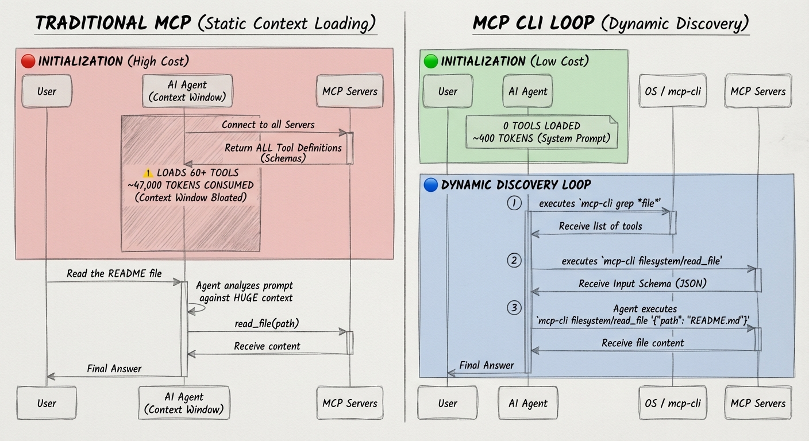

# mcp-cli

輕量的 Rust CLI 與 library，用來和 [MCP Model Context Protocol](https://modelcontextprotocol.io/) 伺服器互動。

> 繁體中文 | [English](./README.en.md)

* * *

## 功能特色

- **輕量**：純 Rust 實作，依賴少，啟動快。
- **單一 Binary**：可透過 Cargo 編譯成完整最佳化的獨立執行檔，不需要外部 runtime。
- **跨平台支援**：提供 Linux (x64/arm64)、macOS (x64/arm64) 與 Windows (x64/x86/arm64) 預編譯原生二進位執行檔。
- **Rust Library**：可在其他 Rust 應用程式中使用相同的 MCP client 功能。
- **Shell 友善**：`call` 指令輸出 JSON，適合搭配 `jq`、pipe 與 shell script。
- **Agent 導向**：設計給 AI coding agents 使用，例如 Gemini CLI、Claude Code 等。
- **通用連線**：支援 stdio、Streamable HTTP 與標準 MCP SSE (HTTP+SSE) 伺服器傳輸協定。
- **連線池**：lazy-spawn daemon 會保留暖連線，預設 60 秒閒置逾時。
- **工具過濾**：可透過設定限制每個伺服器允許或停用的 tools。
- **伺服器指示**：可在輸出中顯示 MCP server instructions。
- **可操作錯誤訊息**：錯誤包含結構化代碼、可用伺服器與修復建議。



* * *

## 應用場景 (Use Cases)

1. **🤖 AI Coding Agents 輕量工具調用 (Token-Efficient Agent Tooling)**
   - 傳統方案直接將所有 MCP Server 的完整 JSON Schema 預先載入 AI 的 Context Window，常耗用數千至上萬 tokens。
   - 透過 `mcp-cli`，AI Agent（如 Gemini CLI、Claude Code、Cursor 等）僅在需要時以單行指令（`mcp-cli info`、`mcp-cli call`）按需 (On-Demand) 查詢 Schema 與執行工具，大幅省下 Token 成本並保持對話脈絡精準。

2. **⚙️ DevOps 與 Shell 自動化管線 (Shell & Pipeline Automation)**
   - `call` 命令原生輸出標準 JSON，完美搭配 `jq`、xargs、curl 與 Shell 管道串接。
   - 例如：定時透過台股 MCP 取得最新報價與投資評分、結合政府開放資料進行即時監控告警，或在 CI/CD 流程中自動執行 MCP 測試。

3. **🌐 跨協定混合整合中心 (Unified Multi-Protocol Hub)**
   - 單一 `mcp_servers.json` 設定檔即可混合管理：
     - 本地進程（`stdio`，如 Node.js / Python / Docker 容器）。
     - 遠端雲端端點（`Streamable HTTP` 與 `標準 MCP SSE (Server-Sent Events)`，支援自訂 Headers 與 Bearer Token 驗證）。
   - 內建背景連線池 Daemon，自動保留熱連線，消除每次重新啟動進程的連線延遲。

4. **🔒 隱私優先與跨平台團隊共用 (Privacy-First & Cross-Platform)**
   - 原生支援 `.env` 檔案與 `${VAR_NAME}` 環境變數替換，團隊可安全共享伺服器設定，而私密 API Key 留在本地不外洩。
   - 一套設定適用於 Linux (x64/arm64)、macOS (x64/arm64) 與 Windows (x64/x86/arm64)。

5. **🛡️ 企業合規與安全治理：因應組織對 MCP 的使用限制 (Enterprise Governance & Restricted Environments)**
   - **組織痛點**：許多企業、金融與受規管機構因資安考量（防範機密外洩、不可逆破壞性操作、黑箱背景連線），嚴格禁止或限制在開發者 IDE 中直接掛載全功能 MCP 伺服器。
   - **解決之道**：
     - **最小權限原則工具過濾 (Least-Privilege Tool Filtering)**：透過 `allowedTools` 與 `disabledTools` 進行強制白名單/黑名單控管（例如：僅開放 `read_*` / `search_*` 唯讀工具，全面停用 `delete_*` / `write_*` 等高風險動作）。
     - **命令列透明度與審計日誌 (Transparent Shell Auditing)**：每一次工具呼叫都是透明可見的 CLI 指令，可直接納入終端操作記錄、CI/CD 稽核軌跡與企業 EDR/SIEM 安全監控，杜絕 IDE 插件的黑箱操作。
     - **即用即關連線控制 (`MCP_NO_DAEMON=1`)**：符合高資安環境規範，禁止常駐後台進程與 Socket 殘留，呼叫結束立即中斷連線與釋放資源。

6. **🔄 跨 AI 工具與跨平台統一樞紐 (Universal Single Source of Truth across Claude, Gemini & Codex)**
   - **痛點**：不同 AI coding 工具（如 Claude Code/Desktop、Gemini CLI/Antigravity、OpenAI Codex、Cursor、Windsurf）各自維護獨立且繁瑣的 MCP 配置設定與路徑，在 Windows、macOS 與 Linux 之間切換時，往往因格式不合或設定分散而陷入「設定地獄 (Configuration Drift)」。
   - **解決之道**：
     - **一次設定，全體共用 (Single Source of Truth)**：只需維護單一 `mcp_servers.json`（或放置於 `~/.config/mcp/`），所有具備 Shell 執行能力的 AI Agent 即可透過標準 `mcp-cli` 指令直接調用，無需為每套 AI 工具重複配置。
     - **跨三大作業系統完全一致**：統一的命令語法與 JSON 輸出格式，不論在 Windows (PowerShell/CMD)、macOS (zsh) 還是 Linux (bash)，AI 都能以相同的提示詞（Prompt）與邏輯無痛切換，大幅簡化跨平台與多 Agent 開發體驗。

* * *

## 已驗證相容的 MCP 伺服器 (Verified MCP Servers)

以下伺服器已在 Windows、macOS 與 Linux 環境下，使用 `mcp-cli` 進行完整傳輸協定測試與工具功能驗證：

| 伺服器名稱 | 實作來源 | 傳輸協定 | 驗證功能與說明 |
| :--- | :--- | :---: | :--- |
| **`filesystem`** | `@modelcontextprotocol/server-filesystem` | `stdio` | 官方檔案系統安全工具，支援目錄讀寫、檔案瀏覽與結構樹（14 個工具）。 |
| **`chrome-devtools`** | `chrome-devtools-mcp` | `stdio` | 官方 Chrome 瀏覽器自動化除錯工具，支援截圖、點擊、效能追蹤與網路監聽（32 個工具）。 |
| **`sequential-thinking`** | `@modelcontextprotocol/server-sequential-thinking` | `stdio` | 思維鏈 (CoT) 推理輔助，提供動態步驟拆解與問題分析。 |
| **`taiwan-stock-bashcat`** | `@bashcat/taiwan-stock-mcp` | `stdio` | 台灣股市全方位分析，支援即時行情、五檔、技術指標、基本面、股利預測與投資評分（16 個工具）。 |
| **`taiwan-gov-data`** | `tw-gov-data-mcp.funtuan.workers.dev` | 遠端 `SSE` | 台灣政府開放資料平台語意檢索，完整驗證 SSE 事件重導向與非同步請求關聯（1 個工具）。 |
| **`twinkle-hub`** | `api.twinkleai.tw` | 遠端 `HTTP` | Twinkle AI 台灣開放資料/專利/判決/法規檢索，驗證 Bearer Token 驗證與動態 Meta-Tool 架構（3 個核心工具）。 |
| **`deepwiki`** | `mcp.deepwiki.com` | 遠端 `SSE` | 遠端知識庫問答、內容閱讀與結構檢索（3 個工具）。 |
| **`taiwan-stock`** | 本地 Python 腳本 (`taiwan_stock_mcp.py`) | `stdio` | 驗證原生 Python 實作之 MCP stdio 傳輸協定。 |

* * *

## 快速開始

### 1. 安裝

```bash
curl -fsSL https://raw.githubusercontent.com/wenchiehlee/mcp-cli/main/install.sh | bash
```

或：

```bash
# 需要先安裝 Cargo
cargo install --git https://github.com/wenchiehlee/mcp-cli
```

也可以透過 npm 安裝：

```bash
npm install -g @wenchiehlee1020/mcp-cli
```

npm package 是一層很薄的 wrapper，會從相同版本的 GitHub Release tag 下載原生 `mcp-cli` binary（支援 Linux、macOS 與 Windows）。例如 `@wenchiehlee1020/mcp-cli@0.1.8` 會下載 `v0.1.8` 的 assets。

### 2. 建立設定檔

在目前目錄或 `~/.config/mcp/` 建立 `mcp_servers.json`：

```json
{
  "mcpServers": {
    "filesystem": {
      "command": "npx",
      "args": [
        "-y",
        "@modelcontextprotocol/server-filesystem",
        "."
      ]
    },
    "deepwiki": {
      "url": "https://mcp.deepwiki.com/mcp"
    }
  }
}
```

### 3. 探索可用 tools

```bash
# 列出所有 servers 與 tools
mcp-cli

# 顯示 descriptions
mcp-cli -d
```

### 4. 呼叫 tool

```bash
# 先查看 tool schema
mcp-cli info filesystem read_file

# 呼叫 tool
mcp-cli call filesystem read_file '{"path": "./README.md"}'
```

* * *

## 使用方式

```text
mcp-cli [options]                             列出所有 servers 與 tools
mcp-cli [options] info <server>               顯示 server tools 與參數
mcp-cli [options] info <server> <tool>        顯示 tool schema
mcp-cli [options] grep <pattern>              用 glob pattern 搜尋 tools
mcp-cli [options] call <server> <tool>        呼叫 tool；未提供 args 時從 stdin 讀取 JSON
mcp-cli [options] call <server> <tool> <json> 使用 JSON arguments 呼叫 tool
```

`info <server> <tool>` 與 `info <server>/<tool>` 兩種格式都可以使用。

> [!TIP]
> 在任何指令加上 `-d` 可顯示 descriptions。

### Options

| Option | 說明 |
|---|---|
| `-h, --help` | 顯示 help message |
| `-v, --version` | 顯示版本號 |
| `-d, --with-descriptions` | 顯示 tool descriptions |
| `-c, --config <path>` | 指定設定檔路徑 |

### 輸出

| Stream | 內容 |
|---|---|
| stdout | Tool results 與 human-readable info |
| stderr | Errors 與 diagnostics |

### Rust Library

在另一個 Rust project 加入 crate：

```toml
[dependencies]
mcp-cli = { git = "https://github.com/wenchiehlee/mcp-cli" }
```

使用 `McpClient` 執行常見流程：

```rust
use mcp_cli::McpClient;

#[tokio::main]
async fn main() -> Result<(), mcp_cli::CliError> {
    let client = McpClient::load(None)?;

    for server in client.server_names() {
        let tools = client.list_tools(&server).await?;
        println!("{server}: {} tools", tools.len());
    }

    let result = client
        .call_tool(
            "filesystem",
            "read_file",
            serde_json::json!({ "path": "./README.md" }),
        )
        .await?;

    println!("{}", mcp_cli::output::format_tool_result(&result));
    Ok(())
}
```

這個 crate 也提供較底層的 modules，例如 `mcp_cli::client`、`mcp_cli::config`、`mcp_cli::errors` 與 `mcp_cli::output`，適合需要直接控制連線或格式化的呼叫端使用。

* * *

## 指令範例

### 列出 Servers

```bash
# 基本列表
$ mcp-cli
github
  • search_repositories
  • get_file_contents
  • create_or_update_file
filesystem
  • read_file
  • write_file
  • list_directory

# 顯示 descriptions
$ mcp-cli --with-descriptions
github
  • search_repositories - Search for GitHub repositories
  • get_file_contents - Get contents of a file or directory
filesystem
  • read_file - Read the contents of a file
  • write_file - Write content to a file
```

### 搜尋 Tools

```bash
# 在所有 servers 中尋找 file 相關 tools
$ mcp-cli grep "*file*"
github/get_file_contents
github/create_or_update_file
filesystem/read_file
filesystem/write_file

# 搭配 descriptions 搜尋
$ mcp-cli grep "*search*" -d
github/search_repositories - Search for GitHub repositories
```

### 查看 Server 詳細資訊

```bash
$ mcp-cli info github
Server: github
Transport: stdio
Command: npx -y @modelcontextprotocol/server-github

Tools (12):
  search_repositories
    Search for GitHub repositories
    Parameters:
      • query (string, required) - Search query
      • page (number, optional) - Page number
  ...
```

### 查看 Tool Schema

```bash
# 兩種格式都可以：
$ mcp-cli info github search_repositories
$ mcp-cli info github/search_repositories

Tool: search_repositories
Server: github

Description:
  Search for GitHub repositories

Input Schema:
  {
    "type": "object",
    "properties": {
      "query": { "type": "string", "description": "Search query" },
      "page": { "type": "number" }
    },
    "required": ["query"]
  }
```

### 呼叫 Tool

```bash
# 使用 inline JSON
$ mcp-cli call github search_repositories '{"query": "mcp server", "per_page": 5}'

# call 指令預設輸出 JSON，適合 pipe 給 jq
$ mcp-cli call github search_repositories '{"query": "mcp"}' | jq '.content[0].text'

# 從 stdin 讀取 JSON，不需要使用 -
$ echo '{"path": "./README.md"}' | mcp-cli call filesystem read_file
```

### 複雜指令

如果 JSON arguments 包含單引號、特殊字元或長文字，建議使用 stdin，避免 shell escaping 問題：

```bash
# 使用 heredoc；call subcommand 不需要 -
mcp-cli call server tool <<EOF
{"content": "Text with 'single quotes' and \"double quotes\""}
EOF

# 從檔案讀取
cat args.json | mcp-cli call server tool

# 使用 jq 建立複雜 JSON
jq -n '{query: "mcp", filters: ["active", "starred"]}' | mcp-cli call github search
```

**使用 stdin 的原因**：shell 會解讀 `{}`、引號與特殊字元，因此需要謹慎 escaping；stdin 可以完全避開 shell 解析。

### 進階串接範例

可以用 pipes 與 shell tools 串接多個 MCP calls：

```bash
# 1. 搜尋並讀取：找出符合 pattern 的檔案，然後讀取第一個
mcp-cli call filesystem search_files '{"path": "src/", "pattern": "*.ts"}' \
  | jq -r '.content[0].text | split("\n")[0]' \
  | xargs -I {} mcp-cli call filesystem read_file '{"path": "{}"}'

# 2. 處理多筆結果：讀取所有符合條件的檔案
mcp-cli call filesystem search_files '{"path": ".", "pattern": "*.md"}' \
  | jq -r '.content[0].text | split("\n")[]' \
  | while read file; do
      echo "=== $file ==="
      mcp-cli call filesystem read_file "{\"path\": \"$file\"}" | jq -r '.content[0].text'
    done

# 3. 擷取與轉換：取得 repo 資訊並擷取 URL
mcp-cli call github search_repositories '{"query": "mcp server", "per_page": 5}' \
  | jq -r '.content[0].text | fromjson | .items[].html_url'

# 4. 條件式執行：讀取前先檢查檔案是否存在
mcp-cli call filesystem list_directory '{"path": "."}' \
  | jq -e '.content[0].text | contains("README.md")' \
  && mcp-cli call filesystem read_file '{"path": "./README.md"}'

# 5. 將輸出儲存到檔案
mcp-cli call github get_file_contents '{"owner": "user", "repo": "project", "path": "src/main.ts"}' \
  | jq -r '.content[0].text' > main.ts

# 6. 在 scripts 中處理錯誤
if result=$(mcp-cli call filesystem read_file '{"path": "./config.json"}' 2>/dev/null); then
  echo "$result" | jq '.content[0].text | fromjson'
else
  echo "File not found, using defaults"
fi

# 7. 彙整多個 servers 的結果
{
  mcp-cli call github search_repositories '{"query": "mcp", "per_page": 3}'
  mcp-cli call filesystem list_directory '{"path": "./src"}'
} | jq -s '.'
```

串接時的注意事項：

- 使用 `jq -r` 取得 raw output，避免字串外層引號。
- 使用 `jq -e` 做條件檢查；false 會回傳 exit code 1。
- 測試時可用 `2>/dev/null` 隱藏錯誤輸出。
- 使用 `| jq -s '.'` 合併多筆 JSON 輸出。

* * *

## 設定

### 設定檔格式

CLI 使用 `mcp_servers.json`，格式相容 Claude Desktop、Gemini 與 VS Code：

```json
{
  "mcpServers": {
    "local-server": {
      "command": "node",
      "args": ["./server.js"],
      "env": {
        "API_KEY": "${API_KEY}"
      },
      "cwd": "/path/to/directory"
    },
    "remote-server": {
      "url": "https://mcp.example.com",
      "headers": {
        "Authorization": "Bearer ${TOKEN}"
      }
    }
  }
}
```

**環境變數替換**：設定檔中任何位置都可使用 `${VAR_NAME}` 語法，CLI 載入時會替換成環境變數值。預設情況下，缺少環境變數會產生清楚的錯誤訊息。設定 `MCP_STRICT_ENV=false` 則會改用空值並顯示 warning。

### .env 隱私與金鑰自動載入

`mcp-cli` 原生支援自動載入 `.env` 檔案，確保您的私密 API 金鑰不需寫死在設定檔中，且不會誤推至 Git 儲存庫：

1. **搜尋順序**：
   - 目前工作目錄：`./.env`
   - 設定檔所在目錄：`<config_dir>/.env`
   - 全域設定目錄：`~/.config/mcp/.env`
2. **使用範例**：
   在 `.env` 中定義金鑰：
   ```env
   TWINKLE_API_KEY=sk-xxxx
   GITHUB_TOKEN=ghp_xxxx
   ```
   在 `mcp_servers.json` 中以 `${VAR_NAME}` 引用：
   ```json
   "headers": {
     "Authorization": "Bearer ${TWINKLE_API_KEY}"
   }
   ```

### Tool Filtering

可使用 `allowedTools` 與 `disabledTools` 限制 server 可用的 tools：

```json
{
  "mcpServers": {
    "filesystem": {
      "command": "npx",
      "args": ["-y", "@modelcontextprotocol/server-filesystem", "."],
      "allowedTools": ["read_file", "list_directory"],
      "disabledTools": ["delete_file"]
    }
  }
}
```

規則：

- `allowedTools`：只有符合 patterns 的 tools 可用，支援 glob：`*`、`?`。
- `disabledTools`：符合 patterns 的 tools 會被排除。
- **`disabledTools` 優先於 `allowedTools`**。
- Filtering 會套用到所有 CLI operations，包括 info、grep 與 call。

範例：

```json
// 只允許 read operations
"allowedTools": ["read_*", "list_*", "search_*"]

// 允許全部，但排除破壞性 operations
"disabledTools": ["delete_*", "write_*", "create_*"]

// 組合使用：允許 file operations，但停用 delete
"allowedTools": ["*file*"],
"disabledTools": ["delete_file"]
```

### 設定檔解析順序

CLI 會依序尋找以下設定來源：

1. `MCP_CONFIG_PATH` environment variable
2. `-c/--config` command line argument
3. `./mcp_servers.json`，目前目錄
4. `~/.mcp_servers.json`
5. `~/.config/mcp/mcp_servers.json`

### 環境變數

| Variable | 說明 | 預設值 |
|---|---|---|
| `MCP_CONFIG_PATH` | 設定檔路徑 | 無 |
| `MCP_DEBUG` | 啟用 debug output | `false` |
| `MCP_TIMEOUT` | Request timeout，單位為秒 | `1800`，30 分鐘 |
| `MCP_CONCURRENCY` | 平行處理的 servers 數量，不是總量限制 | `5` |
| `MCP_MAX_RETRIES` | 短暫錯誤的 retry 次數，`0` 表示停用 | `3` |
| `MCP_RETRY_DELAY` | Retry base delay，單位為毫秒 | `1000` |
| `MCP_STRICT_ENV` | 設定檔中 `${VAR}` 缺失時是否報錯 | `true` |
| `MCP_NO_DAEMON` | 停用連線快取，強制每次建立新連線 | `false` |
| `MCP_DAEMON_TIMEOUT` | Cached connections 的 idle timeout，單位為秒 | `60` |

* * *

## 搭配 AI Agents 使用

`mcp-cli` 的設計目標之一，是讓 AI coding agents 存取 MCP servers。MCP 可讓 AI models 透過標準化 protocol 與外部 tools、APIs 與 data sources 互動。

### 為什麼使用 MCP + CLI

傳統 MCP integration 會把完整 tool schemas 載入 AI 的 context window，可能耗用數千 tokens。CLI 模式的特點如下：

- **按需載入**：只有需要時才取得 schema。
- **節省 tokens**：context overhead 很低。
- **可與 shell 組合**：可搭配 `jq`、pipes 與 scripts。
- **可 script 化**：AI 可以撰寫 shell scripts 處理複雜工作流程。

### 方式 1：整合到 System Prompt

把以下內容加入 AI agent 的 system prompt，即可讓 agent 直接使用 CLI：

````xml
## MCP Servers

You have access to MCP servers via the `mcp-cli` CLI.

Commands:

```bash
mcp-cli info                        # List all servers
mcp-cli info <server>               # Show server tools
mcp-cli info <server> <tool>        # Get tool schema
mcp-cli grep "<pattern>"            # Search tools
mcp-cli call <server> <tool>        # Call tool (stdin auto-detected)
mcp-cli call <server> <tool> '{}'   # Call with JSON args
```

**Both formats work:** `info <server> <tool>` or `info <server>/<tool>`

Workflow:

1. **Discover**: `mcp-cli info` to see available servers
2. **Inspect**: `mcp-cli info <server> <tool>` to get the schema
3. **Execute**: `mcp-cli call <server> <tool> '{}'` with arguments

### Examples

```bash
# Call with inline JSON
mcp-cli call github search_repositories '{"query": "mcp server"}'

# Pipe from stdin (no '-' needed)
echo '{"path": "./file"}' | mcp-cli call filesystem read_file

# Heredoc for complex JSON
mcp-cli call server tool <<EOF
{"content": "Text with 'quotes'"}
EOF
```

### Common Errors

| Wrong | Error | Fix |
|---|---|---|
| `mcp-cli server tool` | AMBIGUOUS | Use `call server tool` |
| `mcp-cli run server tool` | UNKNOWN_SUBCOMMAND | Use `call` |
| `mcp-cli list` | UNKNOWN_SUBCOMMAND | Use `info` |
````

### 方式 2：Agents Skill

支援 Agents Skills 的 code agents，例如 Gemini CLI、OpenCode 或 Claude Code，可以使用 mcp-cli skill 與 MCP servers 互動。Skill 可在 [SKILL.md](./SKILL.md) 取得。

請在你的 skills directory 建立 `mcp-cli/SKILL.md`。

* * *

## 架構

### 連線池 Daemon

CLI 預設使用 **lazy-spawn connection pooling**，避免重複啟動 MCP server 造成延遲：

```text
┌────────────────────────────────────────────────────────────────────┐
│                        First CLI Call                              │
│   $ mcp-cli info server                                            │
└────────────────────────────────────────────────────────────────────┘
                               │
                               ▼
┌────────────────────────────────────────────────────────────────────┐
│ Check: /tmp/mcp-cli-{uid}/server.sock exists?                      │
└────────────────────────────────────────────────────────────────────┘
         │                                    │
         │ NO                                 │ YES
         ▼                                    ▼
┌─────────────────────────┐      ┌───────────────────────────────────┐
│ Fork background daemon  │      │ Connect to existing socket        │
│ ├─ Connect to MCP server│      │ ├─ Send request via IPC           │
│ ├─ Create Unix socket   │      │ ├─ Receive response               │
│ └─ Start 60s idle timer │      │ └─ Daemon resets idle timer       │
└─────────────────────────┘      └───────────────────────────────────┘
         │                                    │
         └────────────────┬───────────────────┘
                          ▼
┌────────────────────────────────────────────────────────────────────┐
│ On idle timeout (60s): Daemon self-terminates, cleans up files     │
└────────────────────────────────────────────────────────────────────┘
```

主要特性：

- **自動化**：不需要手動 start 或 stop。
- **每個 server 獨立**：每個 MCP server 都有自己的 daemon。
- **Stale detection**：設定變更會觸發重新 spawn。
- **快速 fallback**：spawn timeout 為 5 秒，逾時後改用 direct connection。

透過環境變數控制：

```bash
MCP_NO_DAEMON=1 mcp-cli info      # 強制建立新連線
MCP_DAEMON_TIMEOUT=120 mcp-cli    # 2 分鐘 idle timeout
MCP_DEBUG=1 mcp-cli info          # 顯示 daemon debug output
```

### 直接連線模型

停用 daemon 時，`MCP_NO_DAEMON=1`，CLI 會使用 **lazy, on-demand connection strategy**。只有需要時才建立 server connections，使用完立即關閉。

```text
┌─────────────────────────────────────────────────────────────────┐
│                         USER REQUEST                            │
└─────────────────────────────────────────────────────────────────┘
                                │
              ┌─────────────────┼─────────────────┐
              │                 │                 │
              ▼                 ▼                 ▼
    ┌─────────────────┐ ┌─────────────────┐ ┌─────────────────┐
    │   mcp-cli info  │ │ mcp-cli grep    │ │ mcp-cli call    │
    │   (list all)    │ │   "*pattern*"   │ │  server tool {} │
    └─────────────────┘ └─────────────────┘ └─────────────────┘
              │                 │                 │
              ▼                 ▼                 ▼
    ┌─────────────────┐ ┌─────────────────┐ ┌─────────────────┐
    │  Connect to ALL │ │  Connect to ALL │ │  Connect to ONE │
    │  servers (N)    │ │  servers (N)    │ │  server only    │
    └─────────────────┘ └─────────────────┘ └─────────────────┘
              │                 │                 │
              ▼                 ▼                 ▼
         List tools       Search tools       Execute tool
              │                 │                 │
              ▼                 ▼                 ▼
    ┌─────────────────────────────────────────────────────────────┐
    │                    CLOSE CONNECTIONS                        │
    └─────────────────────────────────────────────────────────────┘
```

Server 連線時機：

| Command | 連線的 servers |
|---|---|
| `mcp-cli info` | 平行連線所有 N 個 servers |
| `mcp-cli grep "*pattern*"` | 平行連線所有 N 個 servers |
| `mcp-cli info <server>` | 只連線指定 server |
| `mcp-cli info <server> <tool>` | 只連線指定 server |
| `mcp-cli call <server> <tool> '{}'` | 只連線指定 server |

### 錯誤處理與 Retry

CLI 對短暫性 failures 內建 **exponential backoff 自動 retry**。

會自動 retry 的短暫錯誤：

- Network：`ECONNREFUSED`、`ETIMEDOUT`、`ECONNRESET`
- HTTP：`502`、`503`、`504`、`429`

不會 retry、會立即失敗的錯誤：

- Config：Invalid JSON、missing fields
- Auth：`401`、`403`
- Tool：Validation errors、not found

* * *

## 開發

### 前置需求

- [Rust](https://www.rust-lang.org/) Cargo >= 1.75.0
- [Make](https://www.gnu.org/software/make/) 可選，用於執行 Makefile tasks

### 設定

```bash
git clone https://github.com/wenchiehlee/mcp-cli.git
cd mcp-cli
```

### Makefile Tasks

專案包含 `Makefile`，用於常見的開發、測試、安裝與發布工作。執行 `make` 或 `make help` 可查看所有可用指令：

```bash
$ make help
mcp-cli Management Tasks:
--------------------------------------------------------
all                Build the application in release mode (fully optimized)
build              Build the application in debug mode
build-release      Build the application in release mode (fully optimized)
clean              Remove compiled target files
clippy             Run clippy for static analysis and lint checks
fmt                Check and enforce Rust formatting standards
fmt-fix            Format all Rust source files automatically
help               Show this help menu with descriptions of each command
install            Install the compiled release binary to ~/.local/bin
release            Trigger a new release (usage: make release VERSION=X.Y.Z)
test               Run the native Rust unit tests
uninstall          Remove the mcp-cli binary from ~/.local/bin
--------------------------------------------------------
```

### 本機安裝與測試

若要編譯並安裝 CLI 到本機 `~/.local/bin`，執行：

```bash
make install
```

請確認 `~/.local/bin` 已在你的 `PATH` 中，例如放在 `~/.zshrc` 或 `~/.bashrc`：

```bash
export PATH="$HOME/.local/bin:$PATH"
```

安裝完成後，可從任何位置執行 CLI：

```bash
mcp-cli --help
```

移除 binary：

```bash
make uninstall
```

### 發布

Releases 透過 GitHub Actions 自動化。可使用 Makefile task 觸發 release，該 task 會呼叫 `scripts/release.sh`：

```bash
make release VERSION=0.3.0
```

### 錯誤訊息

所有錯誤都包含可操作的修復建議，適合人類與 AI agents 使用：

```text
Error [AMBIGUOUS_COMMAND]: Ambiguous command: did you mean to call a tool or view info?
  Details: Received: mcp-cli filesystem read_file
  Suggestion: Use 'mcp-cli call filesystem read_file' to execute, or 'mcp-cli info filesystem read_file' to view schema

Error [UNKNOWN_SUBCOMMAND]: Unknown subcommand: "run"
  Details: Valid subcommands: info, grep, call
  Suggestion: Did you mean 'mcp-cli call'?

Error [SERVER_NOT_FOUND]: Server "github" not found in config
  Details: Available servers: filesystem, sqlite
  Suggestion: Use one of: mcp-cli info filesystem, mcp-cli info sqlite

Error [TOOL_NOT_FOUND]: Tool "search" not found in server "filesystem"
  Details: Available tools: read_file, write_file, list_directory (+5 more)
  Suggestion: Run 'mcp-cli info filesystem' to see all available tools

Error [INVALID_JSON_ARGUMENTS]: Invalid JSON in tool arguments
  Details: Parse error: Unexpected identifier "test"
  Suggestion: Arguments must be valid JSON. Use single quotes: '{"key": "value"}'
```

* * *

## Credits

- [Philipp Schmid](https://github.com/philschmid)：原始且優秀的 [Bun/TypeScript mcp-cli](https://github.com/philschmid/mcp-cli) project creator。
- [Antigravity](https://github.com/google-deepmind)：將 codebase 重新設計並完整改寫為高度最佳化、零外部 runtime dependency 的純 Rust CLI。

* * *

## License

MIT License。詳細內容請見 [LICENSE](LICENSE)。

* * *

## Contributing

歡迎提交 contributions。請直接送出 Pull Request。
